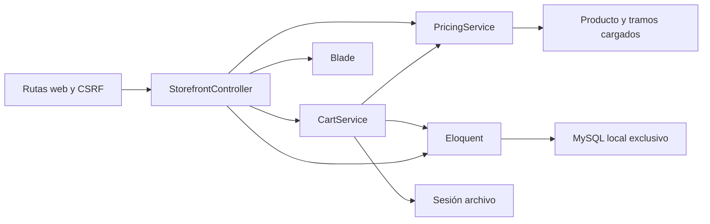
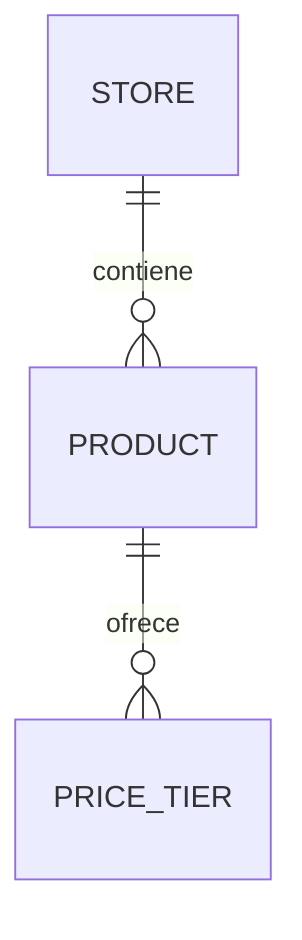
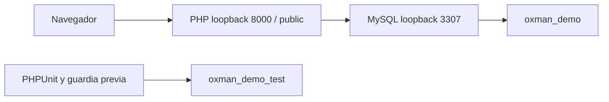

# Arquitectura de la demo local

## Design Paradigm

Monolito en capas; Blade renderizado en servidor y formularios HTML. Aplicación en `app/`. Sin API pública, Node residente, Redis ni workers.

## Invariants & Rules

### AD-1 — Tienda resuelta por servidor [ADOPTED]

- **Binds:** catálogo, ficha y carro.
- **Prevents:** incorporar un SKU de otro comercio mediante identificador cliente.
- **Rule:** la demo resuelve `tecnologia-demo` desde servidor. Toda consulta de producto parte de esa tienda; consultar/agregar/editar exige publicación. Quitar valida pertenencia aunque el producto esté oculto. Nunca confiar en store_id del formulario. Esto solo gobierna la demo pública de una tienda; no acredita aislamiento privado productivo.

### AD-2 — Precio por SKU en CLP entero [ADOPTED]

- **Binds:** precios y carro.
- **Prevents:** suma entre productos o importes manipulados.
- **Rule:** PricingService usa precio/tramos de DB; el mayor umbral alcanzado fija un precio unitario para todas las unidades de ese producto. SKU único por tienda y umbral único por producto en DB. Cantidades enteras positivas hasta stock; jamás precio, importe ni stock del cliente. Subtotal calculado como cantidad por precio unitario. Siguiente tramo solo si se alcanza con stock actual.

### AD-3 — Carro de sesión sin inventario comprometido [ADOPTED]

- **Binds:** carro y vistas.
- **Prevents:** duplicar líneas, reutilizar un carro de otra tienda o asumir reservas.
- **Rule:** CartService es el dueño de `carts.<store_id>.<product_id>`; cada entrada guarda quantity y unit_price previo solo para detectar cambios. Agregar suma; actualizar reemplaza; quitar elimina. Validar toda mutación antes de escribir; rechazo conserva carro válido. En lectura, consultar publicación/stock/precios; precio cambiado informa y recalcula; línea no disponible se elimina con aviso. El carro jamás modifica stock, crea pedido ni cobra.

### AD-4 — Entorno exclusivo y datos ficticios [ADOPTED]

- **Binds:** infraestructura local, migraciones y pruebas.
- **Prevents:** ejecutar migraciones destructivas contra otra instalación.
- **Rule:** MySQL dedicado con datadir `.local/mysql/data`, loopback 3307; solo bases `oxman_demo` y `oxman_demo_test` con usuario limitado a ambas. Tests verifican driver, host, puerto, base, URL/socket antes de RefreshDatabase; abortan ante cualquier otra configuración. No arrancar servicios existentes, reutilizar DB ajena ni desplegar al hosting. Credenciales del ejemplo solo sirven en esta instancia ficticia local.

### AD-5 — HTML y límites explícitos [ADOPTED]

- **Binds:** presentación y HTTP.
- **Prevents:** una interfaz que prometa compras o confíe en el navegador.
- **Rule:** Blade escapa datos; formularios web con middleware CSRF, mensajes españoles y cantidades validadas en servidor. CSS/SVG locales; labels, foco y orden DOM accesibles. Mostrar demo ficticia y no reserva; resumen solo subtotal, despacho por cotizar y total final pendiente. No recoger contactos ni habilitar checkout/panel.

## Consistency Conventions

| Aspecto | Convención |
| --- | --- |
| Dinero | Enteros CLP; representación $ con miles por punto, sin decimales |
| Identidad | IDs DB internos; SKU dentro de tienda; rutas públicas por SKU |
| Errores | Validación redirige con errores y carro previo; oculto/ajeno/inexistente 404 |
| Persistencia | Catálogo/tramos MySQL; sesión y caché archivos; cola sync; sin correo saliente |
| Contratos internos | quote devuelve unit_price/subtotal/minimum/next (remaining/quantity/unit_price); snapshot devuelve lines/notices/subtotal; cada línea contiene product/quantity y quote. Servicios y Blade cambian este contrato juntos. |
| Diseño | DESIGN.md visual; EXPERIENCE.md comportamiento; valores exactos y marca demo como supuestos |

## Stack

Semilla comprobada localmente; código y lock son autoridad desde la implementación.

| Name | Version |
| --- | --- |
| PHP | 8.3.16 |
| Laravel framework | 13.37.0 |
| Skeleton laravel/laravel | 13.0.0 |
| MySQL local | 8.0.30 |
| Composer local | 2.6.5 |
| PHPUnit | 12.5.40 |

Instalación oficial y lock comprobados. Requisitos contrastados con [Laravel deployment](https://laravel.com/docs/13.x/deployment), [sesiones](https://laravel.com/docs/13.x/session), [CSRF](https://laravel.com/docs/13.x/csrf) e [inicialización MySQL](https://dev.mysql.com/doc/refman/8.0/en/data-directory-initialization.html), consulta 2026-10-16. Versiones locales no constituyen selección para producción ni validación de soporte futuro.

## Structural Seed

PHP sirve exclusivamente `app/public`; .env, vendor y datos fuera de la raíz pública. Reiniciar PHP no borra MySQL ni sesiones archivo. El arranque local no instala servicio Windows. Pruebas usan base separada; `RefreshDatabase` borra solo esquema de pruebas tras verificar destino.

## Capability → Architecture Map

| Capability / Area | Lives in | Governed by |
| --- | --- | --- |
| Catálogo/ficha | StorefrontController, Eloquent, Blade | AD-1, AD-5 |
| Precios/tramos | PricingService, price_tiers | AD-2 |
| Sesión y revalidación | CartService | AD-1, AD-3 |
| Demo persistente y pruebas | migraciones, seeder, PHPUnit | AD-4 |

## Deferred

- Pedido, transacción, reserva, concurrencia e idempotencia: otra entrega, previa definición de política; este carro no confirma ventas.
- Panel/autenticación, recuperación, autorización y aislamiento privado entre comercios: requisito antes de cualquier dato real.
- Pago, despacho, impuestos, piloto y contenido autorizado: decisión con Mauro/comercio antes de operación.
- Hosting/HTTPS, versión MySQL mantenida, recursos, respaldos y restauración: comprobar SolucionHost sin tocar sitio anterior; esta entrega es solo local.
- Marca final/fotos y optimización de catálogos grandes: validar con piloto; seis accesorios ficticios por ahora.
